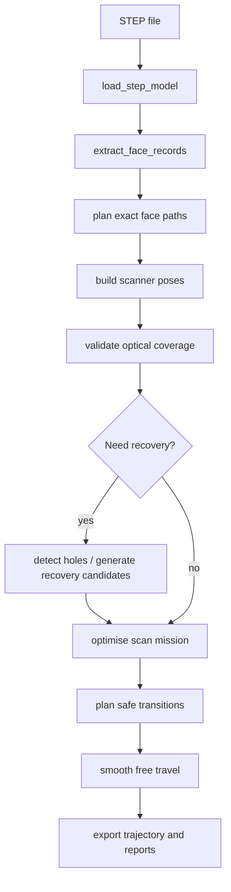

# UR5 STEP Scan Planner: Algorithm Documentation

This document describes the actual architecture, planning flow, configuration system, and export formats used by the current project. The implementation is an offline Cartesian scan-planning system for a UR5 carrying a Micro-Epsilon scanCONTROL LLT30x0-200 scanner.

---

## 1. What this project does

The project reads a STEP file, extracts the authoritative B-Rep faces, plans scan paths directly on those faces, validates optical coverage with a separate tessellated mesh, optionally adds hole/underside recovery views, orders the mission, plans safe free-travel transitions, smooths those transitions, and exports trajectory JSON/CSV plus coverage and validation reports.

The important design choice is that nominal planning is based on exact STEP B-Rep geometry, while the triangle mesh is used only for:

- visualization;
- ray intersection;
- coverage validation;
- visibility checks;
- collision approximation.

---

## 2. End-to-end execution flow

In the current codebase, the main runtime entry point is [main.py](main.py) and the orchestration layer is [app/pipeline.py](app/pipeline.py).

---

## 3. File-by-file responsibilities

### Entry points and orchestration

- [main.py](main.py): CLI entry point. Parses user arguments, builds a PipelineConfig, runs the pipeline, and prints summary/geometry-validation output.
- [app/pipeline.py](app/pipeline.py): Main orchestration layer. Calls the loader, planner, coverage validator, recovery generator, mission optimiser, transition planner, and exporter.
- [app/result.py](app/result.py): Defines the result and summary dataclasses returned by the pipeline.

### Geometry and model loading

- [cad_model.py](cad_model.py): Loads the STEP model, extracts the native B-Rep faces, and builds a separate validation mesh for coverage and collision checks.
- [face_analysis.py](face_analysis.py): Extracts every face from the STEP model, classifies its surface type, computes area/UV bounds, records boundary wires, and captures adjacency.

### Planning modules

- [planners/plane.py](planners/plane.py): Exact planar face planning. Builds a local plane frame, clips raster lanes to the trimmed face boundary, samples travel points, and creates motion segments with approach/lead-in/scan/lead-out/retract poses.
- [planners/cylinder.py](planners/cylinder.py): Exact cylindrical face planning. Supports longitudinal and helical strategies and uses trimmed axial/angular limits.
- [planners/cone.py](planners/cone.py): Exact conical-face planning for conical surfaces.
- [planners/sphere.py](planners/sphere.py): Exact spherical-face planning for spherical surfaces.
- [planners/view_based.py](planners/view_based.py): Lightweight planning based on principal projected views (top/front/right/back/left) plus optional isometric recovery sweeps.
- [planners/base.py](planners/base.py): Shared dataclasses and enums for motion types, planner settings, Pose, raster segments, and plan objects.
- [planners/mission_builder.py](planners/mission_builder.py): Builds a single continuous mission by connecting scan segments with free-travel transitions.
- [planners/safe_transition_planner.py](planners/safe_transition_planner.py): Computes a safe free-space route around the CAD model using a safety envelope, collision checks, and optional smoothing.

### Pose generation and region assembly

- [pose_generation.py](pose_generation.py): Converts raster samples into scanner poses. It creates the scan poses plus approach/lead-in/lead-out/retract transitions, and it guarantees continuous quaternions for each segment.
- [regions.py](regions.py): Groups compatible planar and cylindrical faces into scan regions using adjacency, normal compatibility, and axis/offset tolerances.
- [region_motion.py](region_motion.py): Assembles region-level motion by ordering scan lanes and inserting lane-transition poses while preserving continuity.

### Validation and analysis

- [coverage.py](coverage.py): Runs optical coverage validation by casting laser rays from each scan pose through a tessellated validation mesh. It reports covered, invalid-range, invalid-incidence, and uncovered triangles.
- [geometry_validation.py](geometry_validation.py): Measures stand-off distance and orientation/position change for each generated scan pose.
- [path_validation.py](path_validation.py): Checks that a scan segment is valid with respect to stand-off, spacing, orientation step, and duplicate-pose constraints.
- [features.py](features.py): Detects hole-like features in the CAD model and reports their coverage state.
- [recovery.py](recovery.py): Generates candidate recovery sweeps for holes and underside regions. It includes focused conical-orbit candidates and other recovery strategies.
- [mission_optimizer.py](mission_optimizer.py): Selects the best optional recovery sweeps by scoring expected coverage gain while penalizing long transitions and poor orientation changes.

### Export and GUI

- [exporter.py](exporter.py): Writes the trajectory CSV, trajectory JSON, coverage JSON, validation JSON, and any additional optimisation/feature reports.
- [gui/](gui/): GUI components for configuration, control, viewer updates, and worker tasks.
- [viewer.py](viewer.py): Visualization logic for displaying coverage, scan paths, connectors, and scanner frames.

---

## 4. How the planning flow works

### 4.1 Load and analyze STEP geometry

The process starts with [cad_model.py](cad_model.py) and [face_analysis.py](face_analysis.py):

1. The STEP file is imported through CadQuery/OpenCascade.
2. Every face is extracted as a native TopoDS face.
3. Each face is analyzed for:
   - surface type;
   - area;
   - UV bounds;
   - boundary wires;
   - representative normal;
   - adjacency to neighboring faces.

### 4.2 Generate exact scan paths per surface type

The planner then generates paths directly in the face parameter space rather than from arbitrary mesh samples.

- Planar faces: [planners/plane.py](planners/plane.py)
  - Builds a local plane frame.
  - Generates lanes clipped to the trimmed face boundary.
  - Uses serpentine ordering and travel-spacing samples.

- Cylindrical faces: [planners/cylinder.py](planners/cylinder.py)
  - Uses axial/angular coordinates.
  - Supports longitudinal and helical strategies.
  - Respects trimmed angular and axial limits.

- Other surfaces: [planners/cone.py](planners/cone.py), [planners/sphere.py](planners/sphere.py)
  - Uses the corresponding analytic surface coordinates.
  - Keeps samples inside the trimmed parameter domain.

### 4.3 Convert to scanner poses

[pose_generation.py](pose_generation.py) converts each sampled surface point into a scanner pose. Every scan segment includes:

- approach;
- lead-in;
- scan poses;
- lead-out;
- retract.

The scanner orientation is stored as a quaternion internally, which is the preferred representation for interpolation.

### 4.4 Validate coverage

[coverage.py](coverage.py) shoots a set of laser rays from each scan pose and tests each ray against the validation mesh. A hit is accepted only if it is:

- on an eligible surface;
- within the configured sensor range;
- within the maximum incidence-angle limit.

The result is a triangle-level coverage map with statuses such as uncovered, valid-covered, or visible-invalid.

### 4.5 Recover missing areas

If some regions remain uncovered, [features.py](features.py) and [recovery.py](recovery.py) detect holes and generate recovery candidates such as:

- focused conical orbits;
- lower isometric views;
- underside or bottom sweeps.

[mission_optimizer.py](mission_optimizer.py) scores the candidates and selects the highest-value optional views.

### 4.6 Build a continuous mission

[planners/mission_builder.py](planners/mission_builder.py) connects the selected scan segments into one continuous mission. Between scan segments it inserts free-travel transitions that are checked for collision and clearance.

### 4.7 Smooth and validate free travel

[planners/safe_transition_planner.py](planners/safe_transition_planner.py) performs transition planning using:

- a safety envelope around the CAD model;
- collision checks against the validation mesh;
- optional fixture collision checks;
- position/orientation smoothing.

The smoothing hierarchy is:

1. quintic Bézier or Catmull-Rom spline when possible;
2. fallback to a dense polyline if the smooth candidate fails clearance or collision checks.

---

## 5. Configuration system

The configuration is split between the YAML files in [config/](config/) and the Python dataclass in [app/config.py](app/config.py).

### Main configuration files

- [config/default.yaml](config/default.yaml): baseline settings that are always loaded first.
- [config/fast_preview.yaml](config/fast_preview.yaml): lightweight profile with fewer rays and a smaller recovery budget.
- [config/standard.yaml](config/standard.yaml): balanced profile with more detailed validation and moderate recovery.
- [config/final_validation.yaml](config/final_validation.yaml): high-detail profile with denser rays and more aggressive recovery.
- [config/user_overrides.yaml](config/user_overrides.yaml): user-specific overrides that are layered on top of the selected profile.

### How the config works

The loader in [app/configuration.py](app/configuration.py) merges the YAML files in this order:

1. default values;
2. selected quality profile (fast_preview, standard, or final_validation);
3. user overrides;
4. any GUI overrides.

### Important configuration parameters and what they do

#### Planning controls

- planning.mode: chooses between simple projected-view planning and advanced exact-face planning.
- planning.quality: selects the quality profile used at runtime.
- planning.lane_spacing_mm: the spacing between adjacent raster lanes for exact planar planning.
- planning.minimum_face_area_mm2: faces smaller than this threshold are ignored.
- planning.cylinder_strategy: chooses longitudinal or helical cylindrical planning.
- planning.surface_types: which surface classes are eligible for exact face-based planning.

#### Scanner and optical parameters

- scanner.nominal_standoff_mm: preferred scanner stand-off from the measured surface.
- scanner.travel_spacing_mm: spacing between consecutive scan poses along a scan path.
- scanner.laser_line_width_mm: usable width of the laser line at nominal stand-off.
- scanner.preferred_range_mm: preferred working range for valid scan poses.
- scanner.absolute_range_mm: hard range limits for the scanner sensor.
- validation.maximum_incidence_angle_deg: maximum acceptable incidence angle for a valid ray hit.
- validation.standard_laser_ray_count / final_laser_ray_count: number of simulated rays used for coverage checks.

#### Coverage and recovery parameters

- principal_coverage.top_sweep / side_sweeps / upper_isometric_recovery / bottom_coverage: control the initial scan views and recovery views.
- hole_recovery.enabled: enables feature-based hole recovery.
- hole_recovery.target_coverage_percent: required wall coverage for a hole before recovery can stop.
- hole_recovery.maximum_views_per_hole: cap on the number of recovery views retained for each hole.
- hole_recovery.focused_conical_orbit.*: controls focused orbit recovery around holes.
- mission.total_target_coverage_percent: stop condition for optional mission recovery.
- mission.maximum_optional_sweeps: maximum number of optional recovery sweeps that may be selected.

#### Transition and smoothing parameters

- transition_planning.safety_clearance_mm: minimum free-travel separation from the part envelope.
- transition_planning.vertical_clearance_mm: extra clearance for top/bottom routing.
- transition_planning.tool_envelope_radius_mm: approximate tool/scanner radius for clearance checks.
- transition_planning.envelope_type: OBB or AABB safety-envelope strategy.
- free_travel_smoothing.method: preferred smoothing method for free travel.
- free_travel_smoothing.nominal_blend_radius_mm and minimum_blend_radius_mm: corner-blend radius settings.
- free_travel_smoothing.maximum_route_deviation_mm: allowable deviation from the original safe route.
- orientation_smoothing.maximum_step_deg: maximum orientation change between adjacent transition poses.

---

## 6. Planning qualities

The project exposes three planning-quality profiles.

### fast_preview

Use this profile for quick inspection or coarse planning.

- fewer validation rays;
- simpler hole-recovery candidates;
- smaller optional-sweep budget;
- suitable for preview or debugging.

### standard

Use this profile for balanced planning.

- moderate ray count;
- moderate recovery depth;
- moderate optional-sweep selection;
- good default choice for routine runs.

### final_validation

Use this profile for more thorough validation.

- denser laser-ray coverage;
- more aggressive hole recovery;
- more optional sweeps;
- more computational cost but better confidence in the resulting mission.

In practice, the selected quality profile mainly changes the validation detail and the amount of recovery work that the optimiser is willing to attempt.

---

## 7. Method summary and role of each core method

### main()

In [main.py](main.py), the CLI builds a PipelineConfig from command-line arguments and calls the pipeline. This is the top-level user entry point.

### run_pipeline()

In [app/pipeline.py](app/pipeline.py), run_pipeline() performs the main planning pipeline:

1. validates the config;
2. loads the STEP model;
3. runs either view-based or exact-face planning;
4. validates coverage;
5. runs recovery/optimisation;
6. exports outputs.

### plan_planar_face()

In [planners/plane.py](planners/plane.py), this method plans a single planar face by:

- constructing a local scanner frame;
- generating raster lanes;
- clipping them to the trimmed boundary;
- sampling travel points;
- building a motion segment with approach/scan/retract poses.

### plan_cylindrical_face()

In [planners/cylinder.py](planners/cylinder.py), this method plans a cylinder by building exact axial/angular samples and/or a helical path. It evaluates the trimmed parameter domain and splits the path when the trimmed geometry requires it.

### create_planar_motion_segment() / create_curved_motion_segment()

In [pose_generation.py](pose_generation.py), these methods turn a raster path into scanner motion. They generate a continuous pose set with the correct scanner orientation and the expected approach/lead-in/scan/lead-out/retract phases.

### validate_coverage()

In [coverage.py](coverage.py), this method checks all scan poses by casting rays over the laser line and marking the resulting triangle hits as covered or invalid. It is the core optical validation stage.

### optimise_scan_mission()

In [mission_optimizer.py](mission_optimizer.py), this method greedily chooses optional recovery sweeps according to their expected gain, transition cost, and hole-coverage benefit.

### build_continuous_mission()

In [planners/mission_builder.py](planners/mission_builder.py), this method assembles a single, contiguous mission by linking scan segments with safe transitions instead of allowing direct jumps between unrelated scan regions.

### plan_safe_transition() and smooth_transition_path()

In [planners/safe_transition_planner.py](planners/safe_transition_planner.py), these methods plan collision-safe free-travel paths and then smooth them into curves that preserve clearance. The flow is:

1. compute a safety envelope;
2. attempt a direct route;
3. if blocked, try a detour around the bounding box;
4. validate the candidate with clearance/collision checks;
5. smooth the route with a spline or fallback polyline.

---

## 8. Output file structure

The pipeline writes several files into the chosen output directory.

### trajectory.csv

This is a flat table of all planned poses. Each row is one pose and each column contains the pose data and metadata.

Common columns include:

- global_pose_id
- mission_segment_id
- motion_type
- scan_status
- scan_enabled
- x, y, z
- qx, qy, qz, qw
- rx, ry, rz
- roll_deg, pitch_deg, yaw_deg
- predicted_stand_off_mm
- face_id, region_id, segment_id, pose_id
- surface_x, surface_y, surface_z
- normal_x, normal_y, normal_z
- laser_line_x, laser_line_y, laser_line_z
- travel_x, travel_y, travel_z
- sweep_id, sweep_name, view_type
- feature_id, target_hole_id, recovery_strategy
- transition_id, transition_strategy, clearance_mm

The CSV is useful for importing the plan into external tools or inspecting the mission as a table.

### trajectory.json

This JSON file wraps the same pose information in a structured payload.

Typical top-level structure:

- coordinate_frame: "CAD_STEP"
- position_unit: "mm"
- quaternion_order: "xyzw"
- euler_sequence: "xyz"
- configuration: the effective runtime configuration
- trajectory: the ordered list of pose objects
- mission_statistics: totals such as pose count, scan distance, free-travel distance, and estimated mission time

Each pose is stored as a dictionary with the same information as the CSV columns.

### coverage.json

This file contains:

- configuration: the chosen planning settings;
- surface_report: area-based coverage metrics per surface group;
- exterior_face_ids and internal_face_ids;
- triangle_face_ids and triangle_status: triangle-level coverage status;
- status_codes: meaning of each status value.

### validation_report.json

This file is a mission-level report containing the planning summary, selected sweep order, coverage contributions, and other validation diagnostics.

### additional reports

Depending on the selected pipeline, the exporter may also write:

- feature_report.json
- hole_coverage_report.json
- optimisation_report.json

These contain feature-detection and recovery-analysis results.

---

## 9. Practical interpretation

A good mental model for this project is:

1. exact geometry planning on STEP faces;
2. optical pose generation from those exact samples;
3. coverage validation on a mesh;
4. optional hole/underside recovery;
5. mission selection and ordering;
6. safe free-travel routing and smoothing;
7. export of a complete mission.

The project is deliberately split into geometry, planning, validation, GUI, and export responsibilities so each part can be tested and improved independently.
